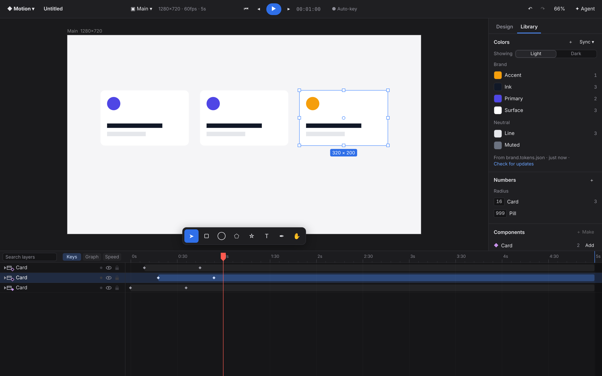
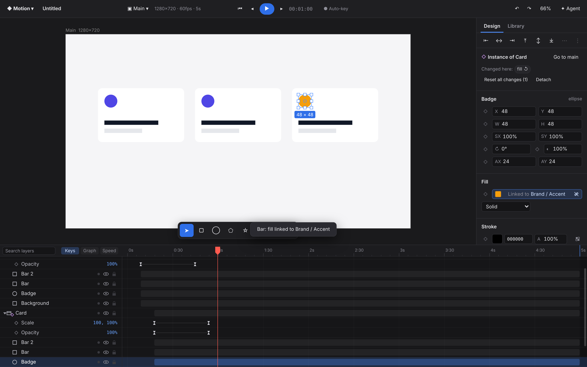
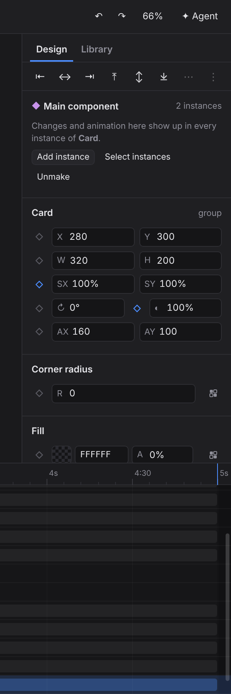
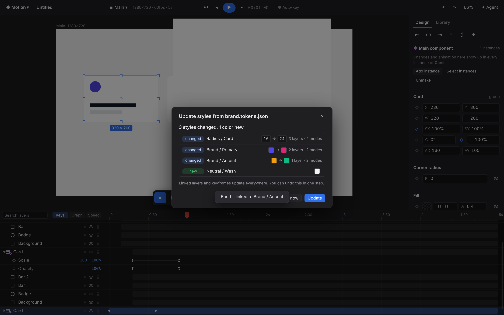
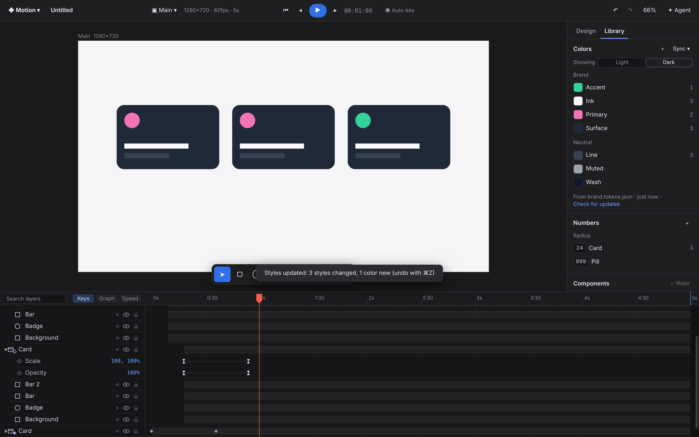

# Components and linked styles (design tokens)

Two features let you build a motion design from a design system rather than from loose layers:

- **Linked styles**: named colors and numbers ("Brand / Primary", "Radius / Card") that layer properties link to. When the library changes, every linked value changes with it.
- **Components**: a main layer (logo, button, card, together with its animation) and instances of it. Changes to the main show up in every instance, and each instance keeps its own changes.

## How to use it

### Colors and numbers (Library tab, left panel)
- **Get styles in**:
  - paste a design from Figma (its color styles and variables come along)
  - or **Sync ▾ → Import tokens file**
  - or select a layer and press **＋** to save its fill as a color
- **Palette**: colors are grouped by name ("Brand / Primary" sits in the *Brand* group). The number on the right of each color is how many layers use it.
- **Click a color** to select every layer that uses it in this composition.
- **Drag a swatch onto a layer** in the canvas to link its fill. Hold ⌥ to link the stroke instead. If you drop it on empty canvas, it goes to the selection.
- **Right-click a color** for:
  - use as the fill or stroke of the selection
  - select the layers that use it
  - change the color, rename, delete. Deleting keeps each layer's current look.
- **Click the swatch** to edit the color. Every linked layer updates while you drag.
- **Light / Dark** (or any other modes) appear as a switch when the library has them. Switching changes every linked value, and it is one undo step.
- **Numbers** work the same way for corner radius, stroke width and opacity.

### In the inspector (Design tab)
- A linked property shows **"Linked to Brand / Primary"** in place of its value.
  - Click the name to pick another style.
  - Click the broken-link icon to **detach**. The value stays the same but stops following the style.
- An unlinked fill, stroke or radius has a small **style button** (four squares). It lists the matching styles, or offers **Save this color as a style…**.
- Typing a different value into a linked property unlinks it, the same as in Figma.
- **Animated properties**: linking applies to the keyframe at the playhead, so a color animation can go from *Brand / Primary* to *Brand / Accent*. When the library changes, linked keyframes update and the animation keeps working.

### Components
- **Make a component**: select a layer or group, then use **⌥⌘K**, the timeline's right-click menu → *Create component*, or Library → **＋ Make**. Agents use `create_component`.
- **Add instances** from:
  - the Library (**Add**)
  - the inspector of the main component (**Add instance**)
  - the main's right-click menu in the timeline
  - agents: `add_instance`, which takes a position and a delay
- **Edit or animate the main**, and every instance follows: property values, keyframes, eases, expressions, text animators, and layers added to or removed from the main.
- **Each instance has**:
  - **its own place**: moving an instance changes only where it plays the main's motion, and it is not an override
  - **its own delay** (inspector → *Delay*): every key of the instance shifts, which makes a staggered row of cards easy
  - **overrides**: any property you change on an instance layer is listed under *Changed here*. Click one to reset it, or use **Reset all changes**. Overridden properties no longer follow the main.
- **Detach** turns an instance into plain layers.
- Deleting the main also turns its instances into plain layers (undo restores the link).
- Timeline: a filled purple diamond on the type icon marks a main component, a hollow one marks an instance.

### Keeping styles in sync with a design library
- **Sync ▾** → *Import tokens file*, *Sync from a URL*, *Sync Figma variables (API)*, and *Update from …* for each source used before.
- A sync never applies on its own. You first see a review ("3 styles changed, 1 color new") with each change as before → after and how many layers use it. **Update** applies everything as **one undo step**.

- A style that disappeared from the library:
  - if layers still use it, it is kept, marked *removed* and struck through, and those layers keep their look
  - if nothing uses it, it is deleted
- A style renamed in the library is renamed here, as long as it keeps its id (Figma variable key or token path). It is not removed and re-added.
- **Desktop app**: a token file you picked is watched. Saving it (for example a Tokens Studio sync in git, or an export script) opens the review automatically.

## Sync options, compared

| path | what it carries | needs | when it updates |
|---|---|---|---|
| **Figma paste** (⌘C in Figma, ⌘V here) | variable and color-style ids, names, values, modes (variables); component definitions and instance overrides | nothing | every paste: pasting from an updated library updates the styles (the toast says e.g. "library: 1 color changed"), and this is part of the paste's undo step |
| **Tokens file** (W3C Design Tokens / DTCG, Tokens Studio, Figma's variables export) | names, values, modes (Tokens Studio sets named light/dark/…), aliases (`{brand.blue}`) | a file (from git, Tokens Studio, a plugin export) | *Update from …*, or automatically when the watched file changes (desktop) |
| **URL** (e.g. a raw GitHub link to the tokens file) | same as a file | a reachable URL (CORS) | *Update from …* |
| **Figma variables REST API** (`GET /v1/files/:key/variables/local`) | variables with collections, modes, aliases, stable keys | a personal access token with `file_variables:read`. **Enterprise plans only**, so it is optional | *Update from Figma variables* |

The Figma token is stored only in that browser's local storage. It is never written to the project file.

**Export**: *Sync ▾ → Export as tokens file* writes the library as W3C Design Tokens (DTCG) JSON. Importing that file again round-trips without changes, which the tests check.

## Design

### Linked styles cost nothing at render time
A linked property keeps its **resolved value** in `prop.v` (or `keyframe.v`) and adds only the style id (`prop.bind`, `keyframe.tok`).

- The renderer, the timeline, Lottie, After Effects and video export, and the agent all keep reading plain numbers.
- No per-frame lookup or allocation is involved, and there is no renderer change at all.
- Whatever changes a style's value (an edit, a mode switch, a sync) rewrites the linked values **inside the same transaction**:
  - `refreshLinked()` makes one pass over the layers
  - it touches only the layers it changed, so they recompile like any other edit
  - undo restores the style values and the layer values together
- One rule keeps this consistent: `tokenTxHook` runs inside every `Store.transact` for the layers the transaction touched.
  - A linked value that no longer equals its style's value was edited by hand, so it is unlinked. This is Figma's behavior.
  - A linked static property that just got keyframes moves its link to the keys that hold the style's value. So pressing the stopwatch on a linked color keeps the link.
  - Code paths that write values directly (agent tools, smart animate, presets, paste) need no special handling.

Data model (`src/core/model.ts`):
- `Project.tokens = { items, modes, mode, sources }`
- `Token = { id, name: 'Brand/Primary', type: 'color' | 'number', values: { [mode]: number[] }, source: { kind, key, from }, missing? }`

Which properties can be linked:
- colors: fill and stroke
- numbers: opacity, corner radius (all corners) and stroke width

Gradient stops are not linkable yet.

### Components are real layers, not a render-time indirection
An instance is a copy of the main's subtree. Each copied layer carries `link: { main, ov? }`, and the instance root also carries `dx`, `dy` (its offset from the main's position) and `dt` (its delay).

**Why copies instead of precomp-style references**:
- Instances render, hit-test, export (Lottie, AE, video) and appear in the timeline like any other layer.
- Every instance layer can be selected, keyframed and overridden.
- Figma instances already paste as layer subtrees.

**Propagation** (`componentTxHook`) runs inside the edit's own transaction, so editing the main and every instance following it is **one undo step**. It does three things:
1. **Overrides**: for an edited instance layer, each field that differs from the main is recorded in `link.ov`, and a field that equals the main's value again is dropped from it. For the root position, a constant offset counts as a move (it updates `dx`, `dy`), not an override.
2. **Structure**: when a main's tree changes (compared against a signature of its subtree), every instance gets the matching layers added, removed or reordered. Layers that were added only to an instance are kept.
3. **Values**: for each edited main layer, the non-overridden fields are copied into every instance layer that mirrors it. Keyframe times shift by the instance's delay, and position values by its offset. This repeats a few passes for nested components.

**What propagates**: props (including keyframes, expressions and links), paints, path geometry and path animation, text and text animators, image, blend, clip, mask, visibility, in/out points.

**What does not**: names, which stay per instance.

**Cost**: the hook exits at once when the project has no components. Otherwise it touches only the layers it changes.

**Precomps vs components**:
- A **precomp** shows another composition with its own clock. Edit it in one place and time-remap it as a whole, but its instances cannot differ.
- A **component** lives in the current timeline. Each instance can be moved, delayed and overridden layer by layer, and still follows the main.
- Use a precomp for a scene, and a component for a reusable element.

### Figma paste
`src/import/figma/convert.ts` reads Figma's kiwi clipboard (field names from the schema embedded in real captures):

- **Variables**:
  - `Paint.colorVar.value.alias` gives a `VariableID { guid, assetRef.key }`
  - the `VARIABLE` node gives the name and `variableDataValues` (per-mode values), and the `VARIABLE_SET` node gives the `variableSetModes` names
  - number variables are read from `variableConsumptionMap` (`OPACITY`, `CORNER_RADIUS`, `STROKE_WEIGHT`)
  - the mode the pasted design was showing becomes the active mode of a new library
- **Color styles**:
  - `styleIdForFill` / `styleIdForStrokeFill` point to the hidden style definition node, which has `key`, `styleType: 'FILL'`, a name and a paint
  - style definitions are no longer imported as layers
- **Components**:
  - `INSTANCE.symbolData.symbolID` points to the `SYMBOL` definition, which is also on the clipboard, with its `componentKey`
  - the definition is converted once and becomes a **main component in a "Components" composition** (laid out in a row)
  - pasted instances are linked to it by tree position, and their differences (text, colors, sizes) become overrides
  - pasting again links new instances to the same main (matched on `figmaKey`)
  - if the main is already animated in Motion, a still Figma instance takes over that animation
- All of this runs inside the paste transaction (`src/core/design-import.ts`), so it is one undo step.

Verified against:
- synthetic messages with Figma's field names (`tests/figma-design.test.ts`)
- the real 2025-format capture: its color style "Heading" (4 linked fills), 7 component definitions and 19 instances come through; the layer count (51) is unchanged. Run `scripts/figma-real-check.sh` once to download it, and the test picks it up.

Variable nodes in real clipboards could not be checked against a capture (none of the public captures use variables). The field names come from the real schema, but how the nodes are placed is an educated guess.

### Sync
`src/core/token-sync.ts`:
- **Parsers** produce `IncomingToken { key, name, type, values: {mode: v}, kind }`:
  - DTCG (`$value` / `$type`, with type inherited from groups, aliases, and 2025 color objects)
  - Tokens Studio (`value` / `type`; multi-set files, where sets named light/dark/… become modes)
  - the Figma REST variables response (resolves aliases per mode)
- `planSync(project, incoming, { from, removeMissing })` matches each incoming token by its library key first, then by name and type. It returns `{ changed (before/after per mode, rename), added, removed (with usage), unchanged }`. This is pure data: the review dialog shows it, and `summarizePlan` writes "2 colors changed, 1 new".
- `applySync` / `applySyncTx`:
  - one transaction
  - merges modes (a library that only had the placeholder "Default" mode adopts the incoming modes)
  - rewrites linked values
  - keeps used removed styles as `missing`
  - remembers the source for *Update from …*

### Agent tools
- `list_styles` (read-only): styles with values in the active mode and usage counts, the modes, components with instance counts
- `link_style`: link or detach (`style: null`)
- `set_style`: create a style or change its value
- `set_style_mode`
- `create_component`
- `add_instance`: component name or id, x/y, delay, parent

`get_layer` and the document summaries name linked styles (`linkedStyles: { fill: 'Brand/Primary' }`), components (`instanceOf`) and overrides. The system prompt asks the agent to prefer linking styles over raw hex values.

## Tests
- `tests/tokens.test.ts`:
  - linking keeps the value resolved, and number styles fill radius corners
  - a style edit is one undo step
  - a hand edit unlinks
  - linked keyframes survive style changes, and editing one key unlinks only that key
  - light/dark switching, and undo of it
  - delete keeps the look
  - sync diff (changed/new/removed/unchanged, the summary text), applied as one undo step that rewrites linked values
  - a removed style that is still used is kept as missing
  - a rename by key
  - color parsing, aliases, Tokens Studio multi-set files, DTCG export round-trip
- `tests/components.test.ts`:
  - an instance is a linked copy
  - propagation as one undo step
  - main animation plays in instances from their own place, with a delay
  - moving is not an override; property and text overrides; reset
  - setting a value back clears the override
  - layers added to or removed from the main (and undo/redo of that)
  - styles flowing through components
  - duplicating an instance makes another instance; detach
  - deleting the main unlinks its instances (undo restores the link)
  - rename is not an override
- `tests/figma-design.test.ts`:
  - variables (two modes), a color style and a component with two instances, one with a text override: names, modes, refs, main component, links, overrides, propagation, dark mode, undo of everything
  - pasting again reuses the main and syncs a changed variable color
  - the real 2025 capture
- `tests/agent.test.ts`: the new tools against a real store, with schema validation.
- `scripts/library-shots.mjs` (Playwright): builds a brand scene and checks that dragging a swatch onto a layer links it, the inspector chip, that the sync review applies, and that undoing the dark mode switch works. It also takes the screenshots above.

## Limits / next
- Gradient stops, text styles (font family, size, weight) and effect styles are not linkable yet. Figma text styles are recognized but not imported as styles.
- One link per layer: an instance nested inside another pasted instance follows the outer instance (Figma behaves the same through the outer main).
- Deleting a layer inside an instance is allowed, and it comes back only when the main's structure changes. Hide layers instead of deleting them.
- Component variants (Figma component sets) paste as separate components.
- Browser builds cannot re-read a picked file without asking. The desktop app re-reads and watches it.
- The REST API path has only been tested with recorded responses, not live, because it needs an Enterprise plan.
