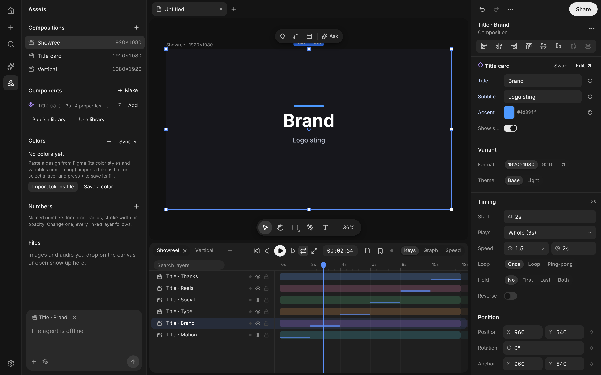
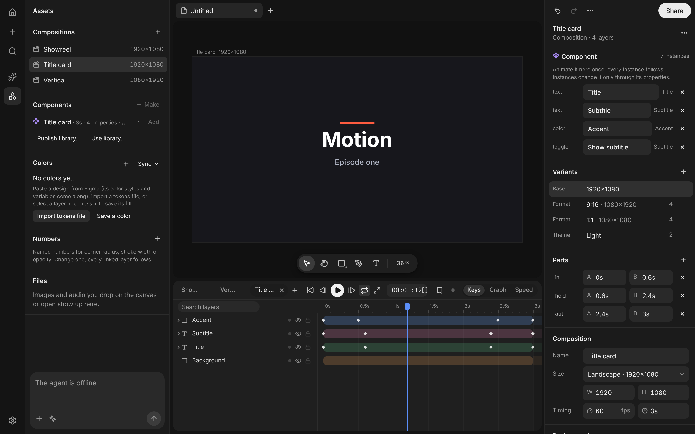
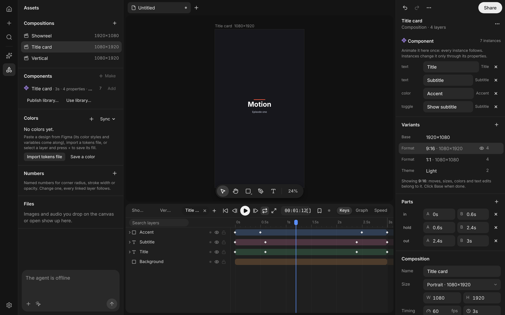
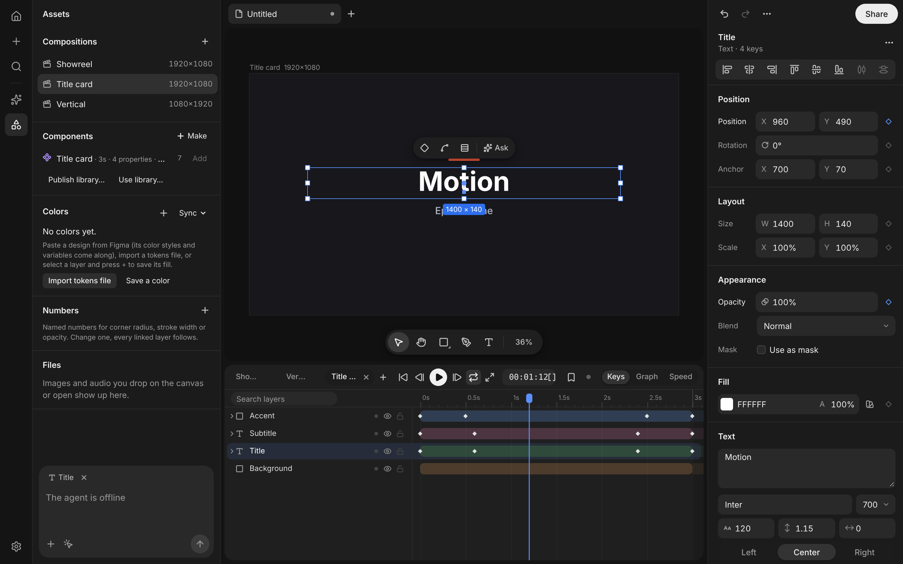
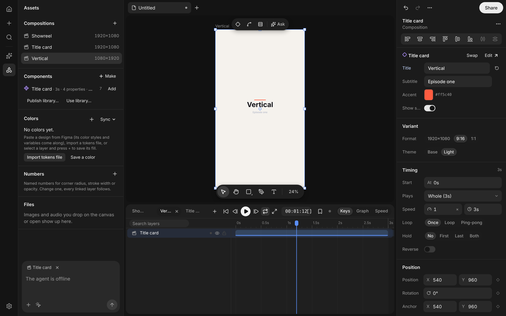
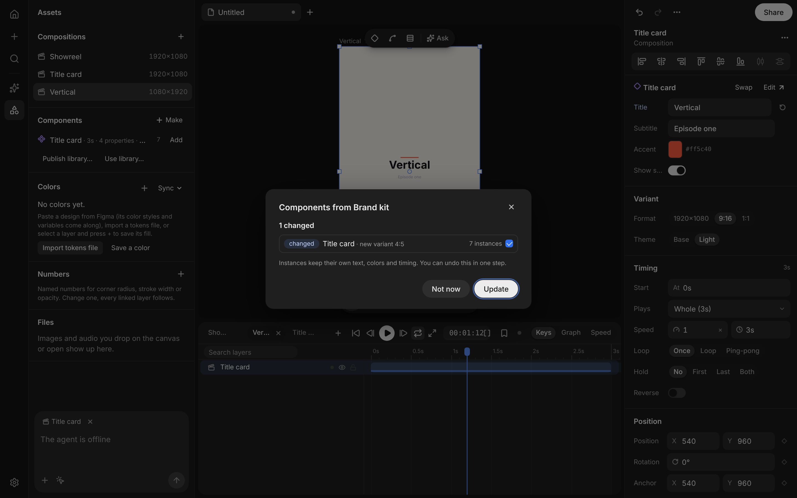

# Components for motion pieces

Motion's components are for **animated brand pieces that get reused, varied and kept in sync across many videos**: logo stings, lower thirds, title cards, end cards, transition wipes, social-format versions of one piece, and showreels assembled from them. They are not interactive runtime components: there are no state machines, inputs or events.



## 1. How other tools do it (research, short)

| tool | what a component is | what varies per use | what to take | what to leave |
|---|---|---|---|---|
| **Figma** | main component + instances (live copies). Component sets hold **variants** (`Theme=Dark, Size=L`). **Component properties**: text, boolean, instance swap, variant. Overrides on any field. Team **libraries** publish; consumers get an update review. | properties, overrides, swap, variant | properties as the public knobs, variants as named combinations, library publish → review → accept | per-layer free overrides as the main mechanism (they make updates unpredictable); no notion of time |
| **After Effects** | **precomps** (a composition used as a layer; time-remap, stretch, start offset). **Essential Graphics / MOGRTs**: a template with **Essential Properties** (text, color, checkbox, slider, dropdown) exposed on the precomp; Premiere sets them per clip. Responsive Design – Time: protected intro / outro regions while stretching. | essential properties, time remap, stretch | the component = composition model; exposed properties instead of reaching inside; protected in/out (named ranges) | the template-file round trip; expressions as the only glue between knobs and layers |
| **Cavalry** | composition references + **attribute promotion** (expose any attribute on the composition), duplicators driving many copies with per-copy values | promoted attributes | procedural per-instance values, cheap many-copies | node graph complexity |
| **Jitter** | no real components; reusable groups and templates, **artboards per format** (resize keeps animation) | per-artboard layout | one animation, many formats | — |
| **Rive** | components (nested artboards) with **state machines**, inputs, events, data binding, runtime | inputs at runtime | nothing structural | **deliberately not copied**: state machines, interactive inputs, runtime listeners, the "app UI" framing |
| **Remotion / Motion Canvas** | code components: a function of props and frame (`<Sequence from durationInFrames>`, `<Loop>`, `playbackRate`) | typed props, sequencing | props as data, sequences with from / duration / loop / rate | code as the authoring surface |
| **Apple Motion** | templates for Final Cut: **published parameters** (rig widgets: checkbox, popup, slider), build in / build out markers that keep their length when the clip is stretched | published parameters, rigs | "build in / build out" timing, rigs = small set of named switches | — |

The common shape for motion pieces is AE's: a **component is a composition**, an **instance plays it on a timeline**, and an instance changes it only through a **small set of published properties**. Figma adds variants, libraries with update review, and the property model.

### Motion before this work, and its gaps
- `core/components.ts`: figma-style **linked copies**. An instance is a full copy of the main's layers carrying `link`, with per-field overrides, an x/y offset and a delay (`dt`, which rewrites every key).
- Gaps for motion pieces:
  - Every instance duplicated every layer, keyframe and geometry, and every main edit rewrote all copies. A 25-layer card × 400 instances meant 10k document layers and 1.5 MB of compiled tracks.
  - Time was a delay only: no speed or stretch, loop, reverse, hold, or playing just the intro.
  - No exposed properties. Any field could be overridden, so there was no "this card has a Title and an Accent".
  - Variants: a Figma component set pasted as unrelated components. No formats (9:16, 1:1), no themes.
  - No library shared across files, apart from token sync for colors.
  - Precomps had their own clock but only a start offset, and every instance looked the same.

## 2. The model

```
Composition.component = {            // a composition IS the component
  ranges:   [{ name: 'in', from, to }, { name: 'hold' }, { name: 'out' }]   // named parts of its timeline
  props:    [{ id, name, kind: text|color|image|number|toggle, targets: [{ layer, field }] }]
  variants: [{ id, group: 'Format'|'Theme'|'Language'|'Cut'|…, name, width?, height?, ov: {layer → differences}, play? }]
  editing?: { variant, base, size }  // a variant shown in the editor
  lib?:     { id, name, key, rev }   // came from a team library
  figmaKey?
}
Layer (precomp) = an instance:
  compRef, startTime
  play: { range | from/to, speed | duration, loop: loop|pingpong, loops, reverse, hold: first|last|both }
  inst: { props: { propId → value }, variants: { group → variantId } }
```

- **An animated component** = its layers + animation + duration + named parts. **Make component** moves the selected top-level layers into a new composition, keeps one instance in their place, and guesses *in / hold / out* when the animation rests in the middle. The *Parts* section edits them. Parts live on the component, not in composition markers.
- **Instances are time-aware.** `instanceTime(comp, play, u)` maps the instance's clock onto the component's:
  - a part or a range
  - speed, or stretch to a length
  - loop or ping-pong, with a number of passes
  - reverse
  - hold the first frame before the start and/or the last frame after the end
  - NaN outside these, meaning the instance is hidden

  Uses: a logo sting at the end with *hold last*, a looping badge playing *hold* on loop, a 3 s title card squeezed into a 2 s slot, a wipe reversed for the way out.
- **Exposed properties replace raw overrides.** A property drives one or more layer fields:
  - text
  - fill or stroke color: keyed colors keep their alpha animation
  - image swap
  - visibility toggle
  - numbers: opacity, rotation, scale. On an animated property, a number scales the swing, so it acts as an *intensity*.
  - `delay`: that layer starts later
  - `prop:<id>`: a property of a **nested** instance, so an outer *Headline* can drive an inner card's *Title*

  An instance stores only the values it sets. *Reset* goes back to the component's value.
- **Variants are differences over the same layers and the same animation**, and they combine across groups (Format × Theme × Language × Cut):
  - layout fields add (position, anchor, size, rotation)
  - scale multiplies
  - colors, opacity, text, font size and visibility replace
  - a variant may also carry default timing, for example *Cut = Short* plays at 1.5×

  A **format variant** gets a responsive first layout: backgrounds stretch to the new frame, and the rest keeps its place around the center and scales to fit 90 % of the frame. **Editing a variant** (click it in the component's *Variants* list) shows it on the real layers at its size. Moves, sizes, colors and texts made there belong to the variant. Keyframe timing and new layers belong to every variant: *animate once, lay out per format*. Leaving records the differences and puts the base back, all undoable.
- **Swap** shows another component in an instance and carries values over by property name.
- **Team library**: *Publish library…* writes the components, the components they nest, their images and the linked styles they use into one `.motionlib.json`. *Use library…* imports it, or opens a **review** when you read the file again. The review lists each component as changed, new or removed, with notes ("new property Accent", "size 1920×1080 → 1080×1080", "new variant 4:5"), the number of instances, and a warning when the local copy was edited. *Update* is one undo step. Property and variant ids are stable across files, so instances keep their text, colors and timing.
- **Figma**:
  - The paste now reads component properties (`componentPropDefs`, the layers bound through `componentPropRefs`), the values each instance assigns (`componentPropAssignments`), and component sets (`isStateGroup` frames with variant names like `Theme=Dark`).
  - Pasted components stay linked copies, since they are static design. **Make animated** (on the main's inspector, or `make_component` with the main) promotes one into an animated component:
    - its Figma text and boolean properties become exposed properties
    - the other mains of its component set that have the same layer structure become **variants**
    - every linked instance becomes an instance with the values it showed
  - Later pastes of that Figma component arrive directly as instances of the animated component, so the link is kept.
- **Linked copies stay** (`core/components.ts`) for static design elements that should be edited layer by layer.




## 3. How it is built

| piece | file |
|---|---|
| model types (PlaySpec, InstanceValues, ExposedProp, Variant, ComponentDef) | `src/core/model.ts` |
| time mapping, properties, variants, resolver, commands, descriptions | `src/core/motion-components.ts` |
| library publish / plan / apply | `src/core/component-library.ts` |
| figma promote + paste as instance | `src/core/figma-components.ts`, `src/import/figma/convert.ts` (`componentMeta`, `propValues`), `src/core/design-import.ts` |
| renderer: time maps, patched layers, in-place recompiles | `src/render/renderer.ts` (`compile` walk, `evalMaps`, `itemT`, dirty-layer path) |
| inspector, component panel, expose, assets rows, library review | `src/ui/ComponentPanels.tsx` (+ small hooks in `Inspector.tsx`, `LibraryPanel.tsx`, `LinkControls.tsx`, `App.tsx`, `timeline.ts`) |
| lottie: per-instance asset when values differ, timing as `tm` time remap | `src/export/lottie.ts` |
| agent tools + guide | `src/agent/tools-components.ts`, `src/agent/guides/components.md` |

**Rendering an instance costs almost nothing extra:**
- **Time.** Every precomp with timing (or nested in one) becomes a *time map node*. Each frame, `evalMaps` maps all nodes once (a few multiplies each), and items read `tmT[node]` instead of `t - tOff`. Plain precomps keep the old path unchanged.
- **Values and variants.** For each instance, `instancePlan` lists only the layers it changes.
  - The compile walk hands every other layer through as the **same Layer object** as the main. Those layers share compiled tracks, and at equal local time they share evaluated values too.
  - A patched layer is a **shallow copy** that shares every untouched Prop object. Tracks are shared per property by Prop identity, so a different title text makes one new text raster and no new tracks.
  - `InstanceResolver` caches the copies, so an unchanged instance hands the renderer the same objects on every compile. Incremental compiles now match items **by layer object**, which lets patched copies be reused too.
- **Editing a component while looking at a composition that uses it** recompiles that layer's occurrences in place (`occ` index) instead of walking the whole scene.

**Agent** (`get_guide "components"`):
- tools: `list_components`, `make_component`, `expose_property`, `set_component_parts`, `add_variant` (also `formats: [...]`), `edit_variant`, `add_component_instance`, `set_instance`, `build_sequence`
- example flows:
  - "make this logo sting a component with text and colour properties": `make_component` → `expose_property` × 2
  - "build a showreel of 6 title cards from the Title component": `build_sequence {component: 'Title', into: 'Showreel', overlap: 0.3, items: [...]}`, and again with `variants: {Format: '9:16'}` for the vertical cut





## 4. Performance (`scripts/cpu-bench.mjs --components instances|copies`)

**Scene:** a 24-layer title card with 22 animated layers. Each instance has its own title, accent color and start time, and they alternate between looping and a 1.5× speed with hold-last. **Container:** software GPU, draw calls stubbed (see NOTES), 120 frames.

| instances | mode | document layers | compiled tracks (pool) | build | edit the main → next frame | frame (median) | eval | write |
|---:|---|---:|---:|---:|---:|---:|---:|---:|
| 25 | **instances** | 49 | **4 KB** | 3 ms | 5 ms | 0.3 ms | 0.1 | 0.1 |
| 100 | **instances** | 124 | **4 KB** | 6 ms | 20 ms | 0.9 ms | 0.3 | 0.4 |
| 400 | **instances** | 424 | **4 KB** | 35 ms | 54 ms | 3.3 ms | 1.1 | 1.5 |
| 25 | linked copies | 650 | 98 KB | 48 ms | 11 ms | 0.4 ms | 0.1 | 0.2 |
| 100 | linked copies | 2 525 | 382 KB | 149 ms | 24 ms | 1.0 ms | 0.3 | 0.4 |
| 400 | linked copies | 10 025 | 1 516 KB | 385 ms | 97 ms | 3.3 ms | 1.1 | 1.5 |

- Compiled animation is shared. The track pool stays at 4 KB for any number of instances, and only the 2 patched layers per instance are copies (shallow ones).
- Documents stay small: 424 layers instead of 10 025. Files, undo snapshots and agent context shrink with them.
- A main edit seen from the showreel was 211 ms at 400 instances before the in-place recompile. It is now 54 ms, faster than propagating to linked copies.
- Per-frame cost is the same as for any layers. Each visible occurrence is still evaluated and drawn, because instances play at different local times. Instances at the same local time reuse one evaluation.
- Checks:
  - `scripts/components-shots.mjs` checks in the real editor:
    - six instances are expanded, with their own titles
    - the unchanged background is one shared layer object
    - the timing hides and shows the right card
    - a main edit reaches every instance and keeps their values
    - the 9:16 variant frame size
    - the vertical instance
    - the library update
  - `scripts/precomp-check.mjs` still passes.

## 5. Tests
- `tests/motion-components.test.ts`:
  - the time mapping: parts, speed, stretch, loop, ping-pong, reverse, hold
  - make component plus guessed parts, as one undo step
  - text, color, toggle and number properties, delay and intensity
  - variant timing, format layout, theme editing, the edit-variant round trip, nested properties, swap
  - resolver identity
  - library publish, import and update with instances keeping their values
  - lottie per-instance assets and time remap
- `tests/agent-tools-components.test.ts`: every tool against a real store, including a three-card showreel with overlap and a 9:16 sequence.
- `tests/figma-components.test.ts`: component properties, bound layers, set variant values and instance values read from Figma's fields; promote with properties, set variants and instance values; a re-paste arriving as an instance; undo.

## 6. Limits and next steps
- **Audio** inside a component plays at its start offset, but speed, loop and reverse do not retime it yet (`src/audio/engine.ts`).
- **After Effects `.jsx`** embeds the Lottie data, so it gets the per-instance assets and the time remap only through that path. Values and variants are not yet native AE Essential Properties.
- Variant "set" differences (colors, opacity) apply to still values. On a keyframed color, use a color *property* instead: it recolors the keys.
- Responsive layout for a new format is a first pass: backgrounds stretch, content fits. Tune each format by editing its variant (`edit_variant`).
- Library files are read on demand (*Use library…*). Watching a library file in the desktop app, as token files are watched, is the next step.
- Figma: instance swap and variant properties are not mapped to exposed properties. Component-set siblings whose layer structure differs stay separate components.
