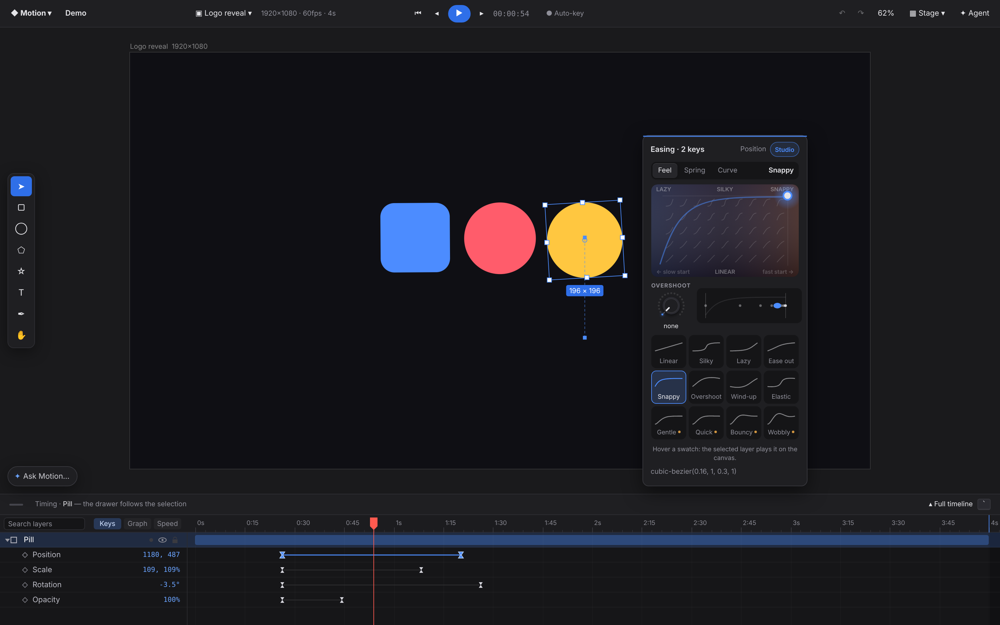
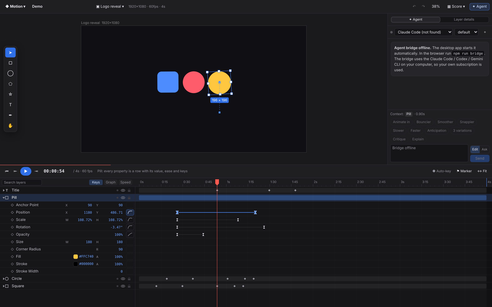
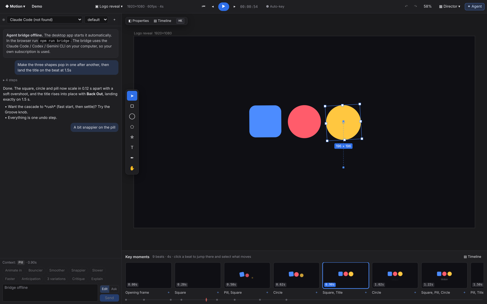
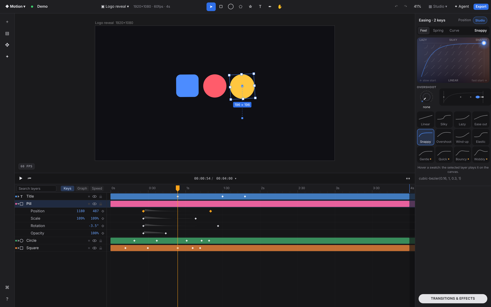

# Window layouts: four alternatives to the After Effects arrangement

Motion's default window is close to After Effects: agent on the left, canvas in the middle,
inspector on the right, timeline along the bottom. That arrangement fits a compositor who
looks at every panel at once. Motion designers mostly work in a loop instead:

1. **Compose** on the canvas (place, shape, style).
2. **Time** it (keys, durations, stagger, beats).
3. **Refine** the easing (feel, overshoot, springs).
4. **Review and export** (play it back, compare moments, hand it off).

The AI agent can help at every one of these steps. It should not be one more docked panel.

This branch adds four layouts next to **Classic**. Each one is built around a different step
of the loop. They are real, working layouts: every one uses the same viewport, timeline,
inspector and agent, with the same logic.

**How to switch**

- the **▦ layout** button in the top bar
- **◆ menu → Layout**
- **⌘K → "Layout: …"**
- the URL: `?layout=classic|stage|score|director|studio` (or `a|b|c|d`)

The last choice is saved. Classic stays the default.

| Layout | Optimizes | Screenshots |
|---|---|---|
| Classic | everything visible at once (AE habit) | `layouts/classic-*.png` |
| **A · Stage** | compose (canvas first) | `layouts/stage-*.png` |
| **B · Score** | time + refine (time is the main axis) | `layouts/score-*.png` |
| **C · Director** | AI collaboration + review (key moments) | `layouts/director-*.png` |
| **D · Studio** | time + refine, timeline-centric (owner's reference) | `layouts/studio-*.png` |

Each layout has these screenshots (2×, demo scene): `-1-selected` (a layer and a key segment
are selected), `-2-playback` (taken during playback) and `-3-agent` (with an agent
conversation). There are also `stage-4-full-timeline`, `director-4-palette`,
`director-5-sheets` and `studio-4-effects`. Regenerate them all with
`URL=http://localhost:5173/ node scripts/layout-shots.mjs`.

---

## A · Stage: canvas first

**Idea.** The canvas is the document, so give it the window. Everything else moves to where
the attention already is.

- **Magnetic inspector card.** The inspector is a floating card that hangs next to the
  selection, on its right, or on its left when there is no room. With nothing selected it
  docks top-right. When keys are selected, the same card turns into the Ease Studio, right
  next to the layer that is moving (`stage-1`).
  - It moves when the selection, the document, the view or the paused time changes.
  - It stays put while you drag on the canvas, so it never chases the layer you are moving,
    and it does not move during playback.
- **Timeline drawer that follows the selection.** The bottom drawer (176 px) lists only the
  selected layers, opened up to their animated properties. The motion you are working on is
  always on screen without scrolling a 40-layer list.
  - **`** (or *▴ Full timeline*) pulls the drawer up to 46 % of the window with every layer
    (`stage-4`). The stage re-fits each way.
- **Floating agent card** (⌘I), or an *Ask Motion…* pill when it is closed.
- **Vertical tool rail** on the stage's left edge. The bottom edge belongs to the drawer.

**Trade-offs.**
- The card covers part of the stage. On a small screen with a big selection it falls back to
  docking.
- Comparing the timing of two unrelated layers needs a multi-select or the full drawer.

**Who it's for.** Designers coming from Figma, Jitter or Rive, and anyone who spends most of
the time composing.

## B · Score: time is the main axis

**Idea.** The layout borrows from a music score or a DAW. The canvas is a *stage* above a
full-width *score*, and the inspector is merged into the score's rows.

- **Score rows.** A selected layer opens **every** property as a row: anchor, position,
  scale, rotation, opacity, size, radius, fill, stroke and stroke width. Each row has, from
  left to right:
  - the add-key diamond
  - inline, scrubbable value fields (X / Y, W / H, a color swatch with hex and alpha)
  - an **ease swatch** for the segment under the playhead: click it to select that segment
    and pick an ease, a spring or hold
  - then the keys themselves.

  You set a value, key it and ease it in one horizontal line, without the eye jumping to a
  side panel.
- **Transport bar** between the stage and the score:
  - play controls and a large timecode
  - previous / next key (J / K)
  - auto-key, add marker and fit
  - a progress hairline, moved with a transform only.
- **Side column** with *Agent* and *Layer details* tabs. Layer details holds the properties
  that have nothing to do with time: text, gradient, blending, mask, presets, rhythm and
  expressions.
- The selected layers open up in the score and close again when they are deselected.

**Trade-offs.**
- The stage is smaller (about 40 % of the height).
- A 24 px row is dense. Long lists of properties need the scroll.
- The fields step aside during playback, and the canvas draws the values instead.

**Who it's for.** Animators who think in timing first (AE power users, motion directors), and
work on rhythm and beats.

## C · Director: talk, then steer by key moments

**Idea.** In this layout the agent is the main way to edit, so it gets a wide 400 px column.
The canvas is the monitor. Under it, a **storyboard of key moments** sums up the animation.

- **Key moments.** Keyframe times, plus markers, are clustered into beats.
  - Each beat is a **real render** (`renderer.snapshot`), re-shot 400 ms after the document
    settles. It is never re-shot during playback or a drag.
  - Click a beat to jump there and select the layers that move at that moment.
  - **✦** on a beat prefills the agent with "At 0.90s (Square, Title): …". *New beat…* asks
    the agent for one.
  - A thread under the cards shows the beats in time, with the playhead on it.
- **Summoned panels.** Nothing else is docked.
  - *Properties* opens the inspector as a sheet on the right.
  - *Timeline* (or **`**) opens the full timeline as a sheet over the storyboard
    (`director-5`).
  - **⌘K** opens a command palette with layouts, panels, playback, tools, export and every
    layer. When nothing matches, the typed text goes to the agent as a prompt
    (`director-4`).

**Trade-offs.**
- Precise key editing needs a summoned sheet.
- Thumbnails cost a few milliseconds per re-shoot. This happens only when idle, but it
  scales with the number of beats (9 at most).

**Who it's for.** Art directors and designers who brief and review rather than push keys,
and anyone working mostly with the agent. It is also a good **review** mode.

## D · Studio: timeline-centric (from the owner's reference)

**Idea.** The owner shared frames of a timeline-centric motion tool they like. Studio takes
its *patterns*: no branding, assets or names.

These ideas **came from that reference**:
- **Timeline bars.** Every layer is a full-width, **saturated bar in a label color**, with a
  matching **dot at the far left of its row**. A group and its children share one color. The
  part of the bar **past the comp end / out point** is a darker tint.
- **Property rows** sit directly under the bar.
  - **Two compact value columns** ("1180  487").
  - An **◇ add-key diamond right before the track**.
  - **Small diamond keys.**
  - A **faint velocity profile** between keys, so the feel of the motion is visible in the
    track.
  - **Selected keys and the playhead turn orange** (`--tl-hot`).
- **Transport above the timeline.** Play and go-to-start on the left; a **centered
  "current / duration ▾"** where the chevron sets the composition duration (presets or
  custom).
- **Window chrome.**
  - A **thin left icon rail**: add, files, compositions, agent, palette, help.
  - A **top bar** with the project name and a status dot on the left, the **tool group
    centered**, and **Export** on the right.
  - A big centered canvas with a small **"60 FPS" badge** at its bottom left (click it for
    the performance HUD).
- **Slim, contextual inspector** (248 px). With keys selected it shows **only the easing
  panel**, which here is our Ease Studio (feel pad, overshoot, swatches, spring and curve
  tabs). With layers selected it shows transform and the layer sections.
- **"Transitions & effects" pill**, bottom right. It opens a **searchable browser** with
  categories:
  - Layer motion, Text motion and Loops: our animation and text presets
  - Easing and Springs: applied to the selected keys.

  Every entry has a **live animated preview**. The ease and spring previews run on the real
  curve (a CSS `cubic-bezier`, and a `linear()` sampled from the spring). Items that need a
  selection say so instead of failing (`studio-4`).

Not taken from the reference: the agent. It opens from the rail as a slide-out over the
stage.

**Trade-offs.**
- Label colors carry no meaning yet: they follow the stacking order. A per-layer label field
  would make them stable.
- The 24 px rows are tighter than in the reference.

**Who it's for.** People who live in the timeline and want it to read at a glance.

---

## How it is built

- **One set of mounted panels.** `App.tsx` always renders the same `.left` (agent),
  `.center` (viewport), `.right` (inspector) and `.bottom` (timeline) in the same tree
  positions. A layout is a class on `.app` (`layout-stage` …) plus its own chrome elements,
  which are keyed and appended after the panels. Switching layouts therefore never re-creates
  the WebGL canvas, the timeline or a running agent turn.
- **Canvas sizing.** The canvases follow through their existing ResizeObservers
  (`renderer.resize`). After a layout switch, or when the stage drawer grows, the composition
  is re-fitted and the timeline re-fits its time scale (`Timeline.relayout`).
- **Timeline modes** (`timeline.ts`, all off in Classic):
  - `focusSelection`: list only the selection and its ancestors
  - `allProps`: an expanded layer lists all of its properties
  - `hideValues`: a DOM overlay edits the values instead
  - `studio`: the label-bar style
  - `onBase`: a hook called after a base redraw, used by the score overlay
  - `HEADER_H` and `ROW_H` are exported.
- **Agent hand-off.** `askAgent(text)` (in `layouts/layout.ts`) opens the agent and prefills
  its input. The storyboard and the palette use it.
- **Files.** `src/ui/layouts/`:
  - `layout.ts`: state, aliases, summon flags
  - `magnet.ts`
  - `StageChrome.tsx`
  - `ScoreFields.tsx`
  - `Transport.tsx`
  - `Storyboard.tsx`, `moments.ts`
  - `Studio.tsx`
  - `CommandPalette.tsx`
  - `layouts.css`: tokens only
  - new tokens in `tokens.css`: `--tl-label-1..8`, `--tl-hot`, `--tl-velocity`, for both
    themes.
- **Performance.** Nothing new runs per frame except:
  - the score transport's timecode and a progress transform
  - the storyboard's playhead transform and active-card check.

  The magnet card is an absolutely positioned, contained element moved with left/top. The
  score overlay re-renders only when rows move or the document changes. Effect previews are
  compositor-only CSS animations and run only while the browser is open.
- **Chromium quirk.** A scroll container placed directly over the WebGL canvas left stale
  tiles in headless Chromium. The floating cards therefore scroll their inner `.inspector`,
  not themselves.
- **Checks.** `tsc`, `vitest` (230 tests) and `scripts/e2e.mjs` (Classic, 25 checks) all
  pass.

## Recommendation

Make **B · Score's row model** and **D · Studio's visual language** the new default timeline,
and keep **A · Stage** as the composing mode one key away. Concretely:

1. **Default = Studio, with the Score rows inside it.**
   - Studio's timeline reads at a glance: colored bars, velocity in the track, orange hot
     state. It is the owner's preference.
   - Its contextual inspector and preset browser beat a permanent 272 px column.
   - Score's inline value fields and per-row ease swatch make the property row the place
     where a value is set, keyed and eased. That is the single biggest workflow gain here, and
     it fits Studio's "two value columns + ◇" row with no layout change.
2. **Stage as the composing mode.** Use the same app with a drawer that follows the
   selection and a magnetic card. It is the best canvas-to-chrome ratio for the compose step,
   and switching is instant because no panel is re-created.
3. **Take from Director:** the **key-moments storyboard**, as a review strip or tab, and
   **⌘K with fallback to the agent** in every layout. Do not make it the default. A
   conversation-first window suits briefing and review, but it slows down hands-on timing.

Classic stays available for AE muscle memory, but it should no longer be the face of the
product.
